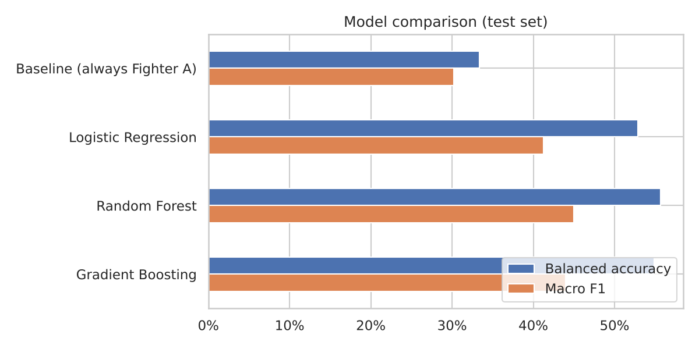
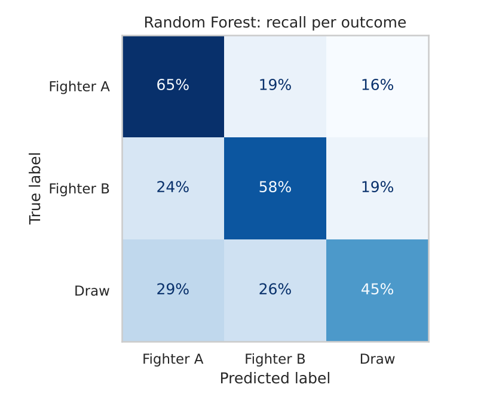
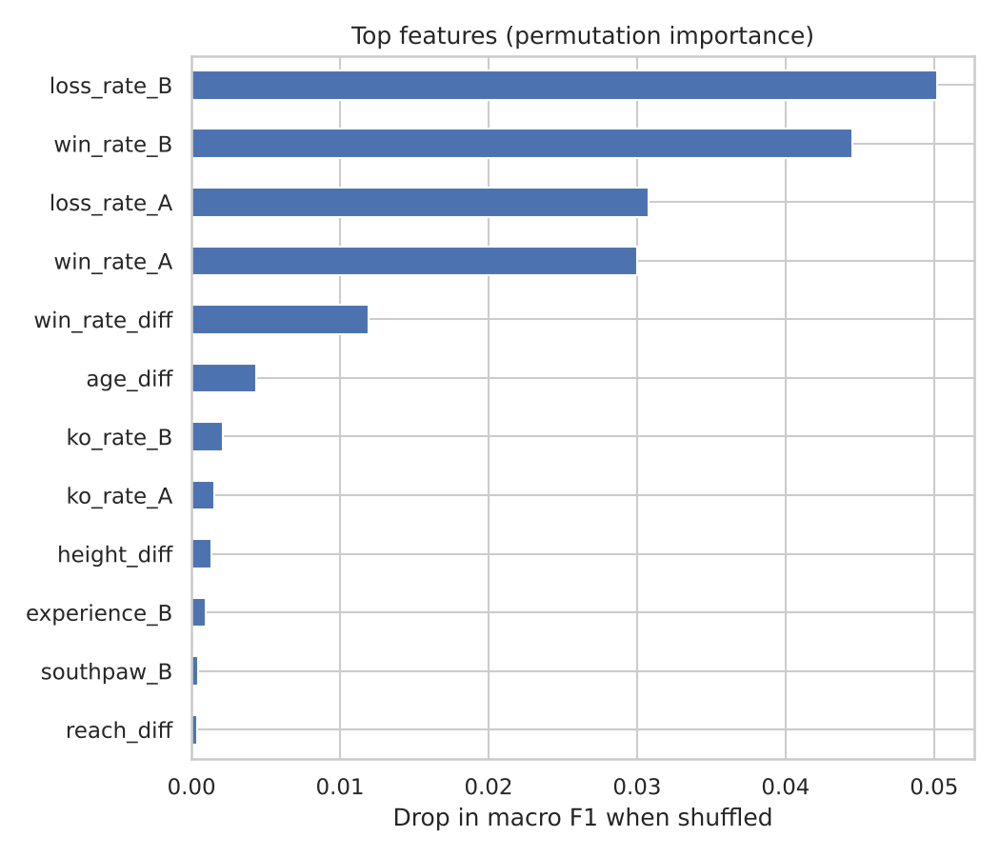

# 🥊 Boxing Matchup Prediction

Predicting the outcome of a professional boxing match (**Fighter A win**, **Fighter B win** or **draw**) from the two boxers' physical attributes and records, trained on **~387,000 bouts** scraped from BoxRec.


<p align="center">
  
</p>

## The interesting part: accuracy lies

Fighter A wins **83%** of bouts in this dataset, so a "model" that always picks Fighter A is 83% accurate while learning nothing. Our first attempts at this project scored 74–79% accuracy and looked reasonable, but they were actually **worse than that do-nothing baseline**.

This version evaluates models on **balanced accuracy** and **macro F1**, which reward getting Fighter B wins and draws right as well, not just the majority class:

| Model | Accuracy | Balanced accuracy | Macro F1 |
|---|---:|---:|---:|
| Baseline (always Fighter A) | 83.0% | 33.3% | 30.2% |
| Logistic Regression | 56.9% | 52.9% | 41.2% |
| Gradient Boosting | 61.0% | 54.9% | 43.9% |
| **Random Forest** | 62.6% | **55.7%** | **45.0%** |

The Random Forest correctly calls **58% of Fighter B wins** and **45% of draws**, where the baseline gets 0% of both.

<p align="center">
  
  
</p>

## What the notebook covers

1. **Exploration:** missing data, and why the target is so imbalanced
2. **Feature engineering:** matchup features (age, height, reach and weight differences), win, loss and KO rates, experience and stance. Post-fight columns such as the judges' scores and decision type are excluded to avoid leakage.
3. **Modelling:** class-weighted Logistic Regression, Random Forest and Histogram Gradient Boosting compared against a baseline
4. **Interpretation:** permutation importance. Fighter records dominate, and physical stats matter much less.
5. **Prediction:** a `predict_fight()` helper, tried on Chris Eubank Jr vs Conor Benn. The model picked unbeaten Benn, and Eubank Jr won. The notebook explains why.

## Run it

```bash
git clone https://github.com/Wiremuloader/Boxing-Matchup-Prediction-App.git
cd Boxing-Matchup-Prediction-App
pip install -r requirements.txt
jupyter notebook notebooks/boxing_prediction.ipynb
```

The full notebook runs in about 2 minutes on a laptop.

## Project structure

```
├── data/
│   └── boxing_matches.csv        # ~387k bouts (BoxRec, via Kaggle)
├── images/                       # charts used in this README
├── notebooks/
│   └── boxing_prediction.ipynb   # full analysis, with outputs
└── requirements.txt
```

## Limitations & next steps

- Fighter records may reflect each fighter's record **when the data was scraped**, not at fight time, which would leak future information. A stricter version would rebuild each record as of the bout date.
- **Opponent quality** is invisible to the model: a 23-0 record against weak opposition looks the same as a 23-0 record against contenders. An Elo-style rating would help.
- A time-based train/test split, plus a small web front end for `predict_fight()`.

## Data

[Boxing Matches dataset](https://www.kaggle.com/datasets/mexwell/boxing-matches) on Kaggle, originally scraped from [BoxRec](https://boxrec.com).

## Credits

Built with Jordan Burmeister and Aimee Gaskin Fryer as a group project for a Data Wrangling & Machine Learning course at Massey University, then rebuilt and extended.
